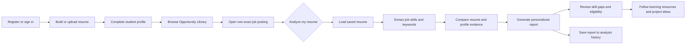
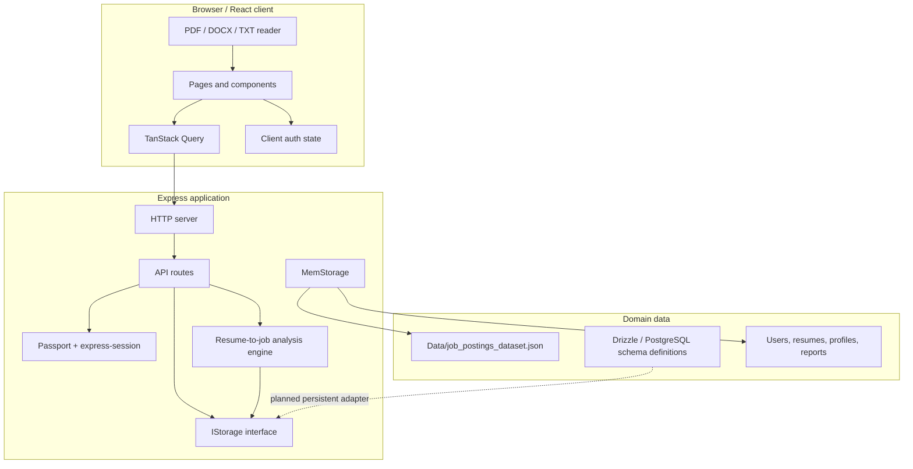
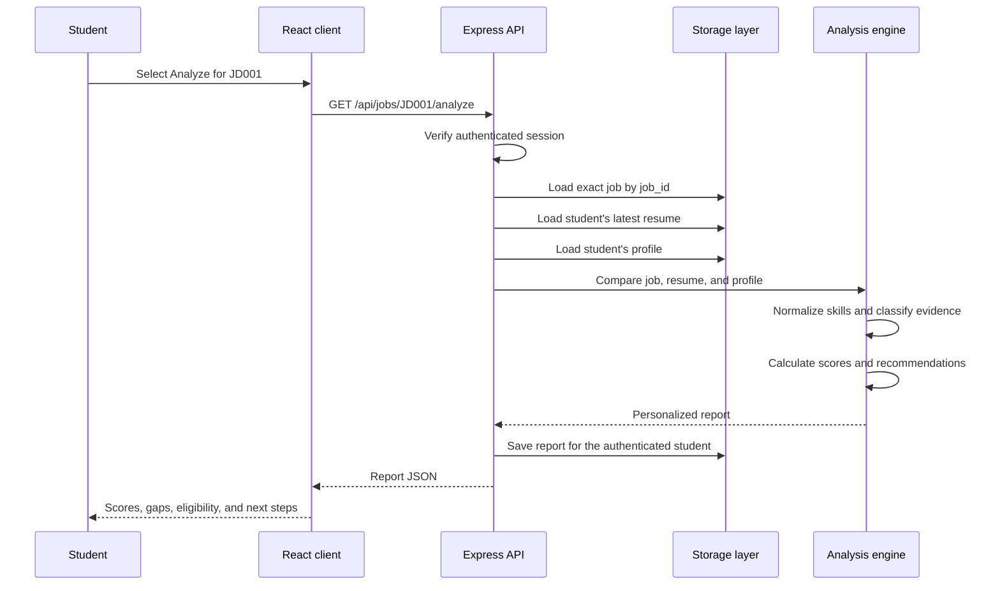

# ResumeHub

## Career Intelligence Platform for Students

ResumeHub is a full-stack career intelligence platform that helps students move from **resume preparation** to **job readiness**.

It brings resume building, resume parsing, ATS screening, job discovery, personalized resume-to-job analysis, skill-gap identification, and placement-readiness tracking into one workflow.

> **Academic project:** REVA University
> **Repository:** [Atharv-M-Patil/Skill_Gap_Analyser](https://github.com/Atharv-M-Patil/Skill_Gap_Analyser)

---

## 1. Product overview

### The problem

Students often use separate tools to:

- build a resume,
- search for jobs,
- check ATS compatibility,
- identify missing skills, and
- decide what to learn next.

Because these activities are disconnected, students do not get a clear answer to the most important question:

> **“How ready am I for this specific job, and what should I do next?”**

### The solution

ResumeHub connects the student's resume, profile, and a selected job posting. It produces an actionable report instead of showing only a generic job description.

For every selected job, the platform can show:

- ATS score,
- keyword coverage,
- required and preferred skill comparison,
- matched skills,
- partially demonstrated skills,
- missing skills,
- education and branch eligibility signals,
- resume improvement suggestions,
- curated learning resources, and
- project ideas for building missing evidence.

---

## 2. End-to-end student workflow



### User journey

1. **Create an account** using email and password, or use Development Demo Mode.
2. **Prepare a resume** in the builder or upload a PDF, DOCX, or TXT file.
3. **Complete profile signals** such as education, skills, projects, certifications, and internships.
4. **Browse jobs** from the 150-record Opportunity Library.
5. **Select an exact posting** using its unique job ID, such as `JD001`.
6. **Run personalized analysis** using the saved resume and current profile.
7. **Understand readiness** through ATS, keyword, skill, and eligibility signals.
8. **Improve intentionally** using the recommended learning resources and project ideas.
9. **Return later** to review previous analysis reports from the student dashboard.

### Details and analysis are separate

```text
/jobs/JD001              Read the selected job
/jobs/JD001/analyze      Analyze the student's resume against JD001
```

The analysis is always tied to the selected `job_id`. Job titles are not used as unique identifiers, so two postings with the same title remain separate opportunities.

---

## 3. System architecture



### Architecture layers

| Layer | Responsibility | Main implementation |
|---|---|---|
| Presentation | Responsive pages, navigation, forms, dashboards, reports | React, Wouter, Tailwind CSS, Radix UI |
| Client data | API calls, cache, loading states, auth-aware UI | TanStack React Query |
| Resume utilities | Read PDF, DOCX, and text files; export resumes | `pdfjs-dist`, `mammoth`, `html2canvas`, `jspdf` |
| HTTP/API | Authentication, jobs, resumes, profiles, reports, analytics | Express 5 and TypeScript |
| Authentication | Local credentials, sessions, protected routes | Passport Local, `express-session` |
| Analysis | Skill extraction, normalization, evidence classification, scoring | `server/routes.ts` |
| Storage boundary | Application-facing persistence contract | `IStorage` in `server/storage.ts` |
| Development persistence | Fast local execution without a database | `MemStorage` |
| Database model | PostgreSQL-ready table definitions | Drizzle ORM in `shared/schema.ts` |

### Request and analysis data flow



---

## 4. Personalized analysis model

### Inputs

The analysis engine combines three inputs:

1. **Selected job posting**
   - job title,
   - description,
   - education requirement,
   - experience range,
   - required skills, and
   - preferred skills.
2. **Saved resume**
   - extracted text from the uploaded file,
   - resume metadata, and
   - builder content where available.
3. **Student profile**
   - education,
   - skills,
   - projects,
   - certifications, and
   - internships.

### Skill extraction and normalization

The backend reads skill statements from the job description and normalizes common aliases before comparison.

Examples:

| Input variants | Normalized value |
|---|---|
| `JS`, `JavaScript` | `javascript` |
| `Postgres`, `PostgreSQL` | `postgresql` |
| `Amazon Web Services`, `AWS` | `aws` |
| `React.js`, `ReactJS` | `react` |
| `REST API`, `RESTful APIs` | `rest apis` |

### Evidence classification

| Classification | Meaning |
|---|---|
| Matched | The skill is explicitly present in the structured student profile |
| Partially demonstrated | The keyword appears in extracted resume text, but structured project or experience evidence is not recorded |
| Missing | No matching evidence was found; the report provides a next step |

### Score definitions

| Metric | Meaning |
|---|---|
| ATS score | Combined estimate of resume keyword alignment and demonstrated skill fit |
| Keyword coverage | Percentage of selected job keywords found in the extracted resume text |
| Skill match score | Weighted match across required and preferred skills |
| Profile completion | Percentage of profile sections containing information |

Current skill weighting:

- **Required skills:** 80%
- **Preferred skills:** 20%
- **Resume-only keyword evidence:** partial credit

The report is an advisory signal, not a hiring decision or a guarantee of eligibility.

---

## 5. Feature modules

### Student workspace

| Module | What it does |
|---|---|
| Home | Explains the platform and shows platform-level opportunity statistics |
| Resume Builder | Creates a structured resume with live preview and PDF export |
| Resume Vault | Uploads, extracts, stores, replaces, and deletes owned resumes |
| ATS Screener | Checks a resume against pasted or uploaded job-description content |
| Opportunity Library | Searches and browses the 150 job postings |
| Job Details | Shows one exact job posting and its requirements |
| Personalized Analysis | Produces the resume-to-job report |
| Student Dashboard | Shows profile completion, recent analyses, and readiness signals |

### Authentication and account boundaries

- Email/password registration and login
- Session-based authentication
- Development-only Demo Mode
- Auth-aware redirects back to the requested page
- User-scoped resume, profile, analytics, and report access
- Google OAuth intentionally removed

---

## 6. Opportunity Library dataset

The source dataset is [Data/job_postings_dataset.json](./Data/job_postings_dataset.json).

| Dataset characteristic | Current value |
|---|---|
| Postings | 150 |
| Companies | 25 |
| Role families | 6 |
| Identifier | Unique `job_id` |
| Data handling | Loaded at server startup |
| Duplicate titles | Preserved as separate records |
| Data nature | Synthetic / representative records |

The dataset is loaded into the storage layer and exposed through the jobs API. Each record is kept as an individual opportunity even when title, company type, or description patterns overlap.

---

## 7. Application routes

| Route | Purpose | Access |
|---|---|---|
| `/` | Career intelligence landing page | Public |
| `/login` | Login, registration, and Demo Mode | Public |
| `/student` | Student dashboard | Authenticated |
| `/resume` | Resume vault and upload | Authenticated |
| `/builder` | Resume builder | Public / account-aware |
| `/screener` | ATS screening workspace | Public / account-aware |
| `/jobs` | Opportunity Library | Public |
| `/jobs/:jobId` | Exact job details | Public |
| `/jobs/:jobId/analyze` | Personalized analysis | Authenticated |

---

## 8. API reference

### Health and authentication

| Method | Endpoint | Purpose |
|---|---|---|
| `GET` | `/api/health` | Basic service health |
| `GET` | `/api/ready` | Readiness check |
| `GET` | `/api/auth/me` | Read current session state |
| `GET` | `/api/auth/config` | Read available local/demo auth options |
| `POST` | `/api/auth/register` | Register a user |
| `POST` | `/api/auth/login` | Start a session |
| `POST` | `/api/auth/logout` | End a session |
| `POST` | `/api/auth/dev-login` | Start Development Demo Mode |

### Jobs and analysis

| Method | Endpoint | Purpose |
|---|---|---|
| `GET` | `/api/jobs` | List and search job postings |
| `GET` | `/api/jobs/:jobId` | Read one exact posting |
| `GET` | `/api/jobs/:jobId/analyze` | Generate and save a personalized report |
| `GET` | `/api/platform/stats` | Read platform-level job statistics |

### Student data

| Method | Endpoint | Purpose |
|---|---|---|
| `GET` | `/api/student/profile` | Read the current student's profile |
| `PUT` | `/api/student/profile` | Save the current student's profile |
| `GET` | `/api/student/resume` | Read the current student's latest resume |
| `GET` | `/api/student/analytics` | Read dashboard metrics |
| `GET` | `/api/student/analyses` | Read owned analysis history |
| `GET` | `/api/student/analyses/:id` | Read one owned report |

### Resume resources

| Method | Endpoint | Purpose |
|---|---|---|
| `GET` | `/api/resumes` | List owned resumes |
| `POST` | `/api/resumes` | Save an extracted resume |
| `PUT` | `/api/resumes/:id` | Update an owned resume |
| `DELETE` | `/api/resumes/:id` | Delete an owned resume |

### Placement officer foundation

| Method | Endpoint | Purpose |
|---|---|---|
| `GET` | `/api/officer/summary` | Read officer-level summary when authenticated as an officer |

---

## 9. Project structure

```text
.
├── Data/
│   └── job_postings_dataset.json       # 150 representative job postings
├── client/
│   ├── public/                         # Logo and favicon assets
│   └── src/
│       ├── components/                 # Shared UI and layout components
│       ├── hooks/                      # Client hooks
│       ├── lib/                        # Auth, API, and file parsing helpers
│       └── pages/                      # Builder, jobs, resume, student, screener
├── server/
│   ├── index.ts                        # Express/Vite server entry point
│   ├── routes.ts                       # API routes and analysis engine
│   ├── static.ts                       # Production static-file serving
│   ├── storage.ts                      # IStorage and MemStorage
│   └── vite.ts                         # Development Vite integration
├── shared/
│   └── schema.ts                       # Drizzle/PostgreSQL domain schema
├── script/
│   └── build.ts                        # Client and server build orchestration
├── package.json
└── README.md
```

---

## 10. Technology stack

| Area | Technologies |
|---|---|
| Client | React 19, TypeScript, Wouter |
| UI | Tailwind CSS v4, Radix UI, Framer Motion, Lucide |
| Client data | TanStack React Query |
| Server | Node.js, Express 5, TypeScript |
| Authentication | Passport Local, `express-session`, Memorystore |
| Resume parsing | `pdfjs-dist`, `mammoth` |
| Resume export | `html2canvas`, `jspdf` |
| Validation | Zod, Drizzle Zod |
| Data model | Drizzle ORM, PostgreSQL schema definitions |
| Local runtime storage | In-memory `MemStorage` |
| Build | Vite, esbuild, tsx |

---

## 11. Run locally

### Requirements

- Node.js 20 or newer
- npm

### Install

```bash
npm install
```

### Environment variables

Create a `.env` file when needed:

```env
SESSION_SECRET=replace-with-a-long-random-value
DATABASE_URL=
```

`SESSION_SECRET` is recommended for deployment. Development has a fallback so the project can run locally without additional configuration.

### Start development mode

```bash
npm run dev
```

Open [http://localhost:5030](http://localhost:5030).

The server probes nearby ports if `5030` is already in use.

### Available scripts

```bash
npm run dev       # Start the Express/Vite development server
npm run check     # Run TypeScript validation
npm run build     # Build the client and production server bundle
npm run start     # Start the production bundle
npm run db:push   # Push the Drizzle schema to PostgreSQL
```

---

## 12. Deploy to Render

The repository includes a Render Blueprint at [`render.yaml`](./render.yaml). It configures a Node web service with:

- `npm ci && npm run build` as the build command,
- `npm run start` as the production start command,
- `NODE_ENV=production`,
- an automatically generated `SESSION_SECRET`, and
- `/api/health` as the health-check endpoint.

### Option A: Deploy with the Blueprint

1. Push the repository to GitHub.
2. Open the [Render Dashboard](https://dashboard.render.com/).
3. Select **New → Blueprint**.
4. Connect the `Atharv-M-Patil/Skill_Gap_Analyser` repository.
5. Select the branch containing `render.yaml`, normally `main`.
6. Review the service settings and click **Apply**.
7. Wait for the build to finish.
8. Open the generated `onrender.com` URL and verify the landing page.
9. Verify the health endpoint at:

   ```text
   https://YOUR-SERVICE-NAME.onrender.com/api/health
   ```

### Option B: Create the service manually

Use these Render web-service settings:

| Setting | Value |
|---|---|
| Runtime | Node |
| Build command | `npm ci && npm run build` |
| Start command | `npm run start` |
| Health check path | `/api/health` |
| Node version | `20` or newer |
| `NODE_ENV` | `production` |
| `SESSION_SECRET` | A long random secret |

Render automatically supplies the `PORT` variable. The server listens on that port and on `0.0.0.0`, which is required for public Render traffic.

### Important deployment limitation

The current application uses in-memory `MemStorage` at runtime. On Render, data can be lost when the service restarts, redeploys, or is moved to another instance. This affects:

- registered users,
- sessions,
- uploaded resumes,
- student profiles, and
- saved analysis reports.

The 150-job dataset is safe because it is loaded from the repository at startup. For a production deployment with persistent student accounts and reports, connect the existing Drizzle schema to a managed PostgreSQL database and use a PostgreSQL-backed storage implementation.

### Render deployment troubleshooting

- **Build fails:** confirm the service is using Node 20 or newer and that `package-lock.json` is committed.
- **Service fails to start:** check the Render logs for the `npm run start` command and confirm the build produced `dist/index.cjs`.
- **Health check fails:** open `/api/health`; the endpoint should return a successful JSON response without authentication.
- **Users are logged out after a restart:** this is expected while sessions use the in-memory session store.
- **Resume data disappears:** this is expected while application data uses `MemStorage`.

---

## 13. Persistence and deployment status

The project currently uses `MemStorage` at runtime. This is intentional for easy local demonstration:

- the application starts without a provisioned database,
- the job dataset is loaded from the repository,
- users, resumes, profiles, and reports are stored in memory, and
- user-created data resets when the server restarts.

The repository also contains Drizzle/PostgreSQL definitions for:

- users,
- resumes,
- job postings,
- required job skills,
- student profiles, and
- analysis reports.

Before production deployment, the storage interface should be connected to persistent PostgreSQL repositories and migrations should be managed safely. Running `db:push` alone does not migrate the current `MemStorage` behavior.

---

## 14. Security behavior

- Protected student endpoints require an authenticated session.
- Resume, profile, analytics, and report queries are scoped to the authenticated user ID.
- Students cannot read another student's resume or analysis report.
- Officer checks are enforced server-side for officer-only endpoints.
- Passwords are hashed with Node.js `scrypt`.
- Session cookies are HTTP-only.
- Job lookup uses exact `job_id` values.
- Secrets belong in environment variables and must not be committed.
- `/api/auth/me` returns an unauthenticated state for logged-out users; protected resources return `401`.

---

## 15. Validation

Run the following before submitting changes:

```bash
npm run check
npm run build
git diff --check
```

The production build may report a warning about large client chunks; this does not currently fail the build.

---

## 16. Roadmap

The current foundation is ready for the next product phase:

- replace `MemStorage` with persistent PostgreSQL repositories,
- add safe database migrations and seed handling,
- complete placement officer dashboards,
- add JSON upload, validation, duplicate detection, preview, and import history,
- add full section-by-section student profile editing,
- store persistent extracted-skill evidence,
- track learning-resource progress and completion,
- version analysis reports against resume versions,
- add automated end-to-end tests for authentication and Student A/Student B isolation,
- add production deployment configuration, and
- split large client bundles for faster initial loading.

---

## License

This project is distributed under the MIT License.
