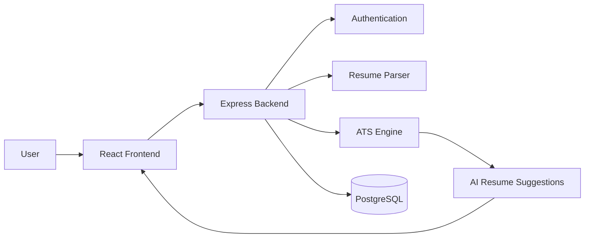
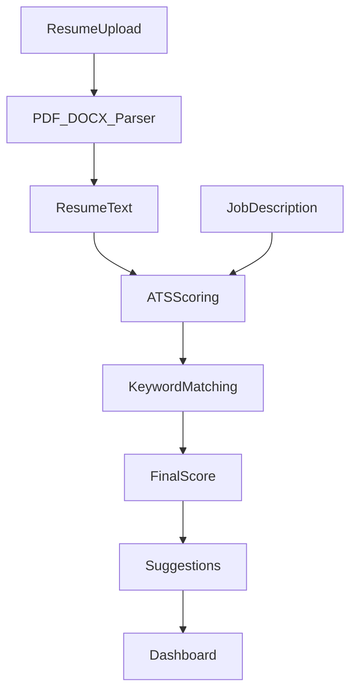

# 📄 ResumeHub – AI-Powered Resume Builder & ATS Tracker

> An intelligent resume builder that helps job seekers create professional resumes, optimize them for Applicant Tracking Systems (ATS), and improve interview chances using AI-powered resume enhancement and ATS analysis.

<p align="center">

[](https://resume-builder-and-ats-tracker-1.onrender.com)


</p>

---

# 📑 Table of Contents

- Overview
- Demo
- System Architecture
- Tech Stack
- Project Structure
- Database Design
- API Overview
- Key Features
- ATS Scoring Algorithm
- Security
- Performance & Scalability
- Installation
- Deployment
- Future Improvements
- Interview Talking Points

---

# 🚀 Overview

ResumeHub is an AI-powered web application that enables users to build professional resumes, evaluate them using a custom Applicant Tracking System (ATS), and optimize resumes for specific job descriptions.

The platform combines modern frontend technologies, backend services, document parsing, authentication, and AI-assisted content generation to provide a complete resume optimization workflow.

---

# ❓ Problem Statement

Many job seekers submit resumes that fail Applicant Tracking Systems before reaching recruiters.

Common problems include:

- Poor resume formatting
- Missing keywords
- Weak project descriptions
- Low ATS compatibility
- Generic resume content

ResumeHub addresses these challenges by generating ATS-friendly resumes and providing detailed scoring with personalized improvement suggestions.

---

# ✨ Key Features

## 📄 Resume Builder

- Five Professional Resume Templates
- AI-powered Resume Enhancement
- Live Resume Preview
- PDF Export
- Resume Import (PDF & DOCX)
- Automatic Data Extraction
- Section-based Navigation
- Persistent Form State

---

## 📊 ATS Resume Screener

- Resume Parsing (PDF & DOCX)
- Job Description Analysis
- ATS Compatibility Score
- Keyword Matching
- Resume Recommendations
- Missing Skills Detection
- Searchable ATS Reports

---

## 🔐 Authentication

- Email & Password Login
- Google OAuth Authentication
- Session Management

---

# 🎥 Demo

### 🌐 Live Application

https://resume-builder-and-ats-tracker-1.onrender.com

### Screenshots

| Resume Builder | ATS Analysis |
|---------------|--------------|
| *(Add Screenshot)* | *(Add Screenshot)* |

| Resume Preview | Dashboard |
|----------------|-----------|
| *(Add Screenshot)* | *(Add Screenshot)* |

---

# 🏗️ System Architecture



---

# 🔄 Resume Processing Workflow



---

# 🛠️ Tech Stack

| Layer | Technology | Purpose |
|--------|------------|----------|
| Frontend | React 19 + TypeScript | Modern User Interface |
| Styling | Tailwind CSS + Radix UI | Responsive UI Components |
| Backend | Express.js | REST APIs |
| Authentication | Passport.js | Google OAuth & Local Login |
| Database | PostgreSQL | User & Resume Storage |
| ORM | Drizzle ORM | Database Management |
| Resume Parsing | pdfjs-dist, Mammoth | PDF & DOCX Processing |
| AI | OpenAI APIs (Optional) | Resume Enhancement |
| Animation | Framer Motion | Smooth User Experience |

---

# 📂 Project Structure

```text
ResumeHub
│
├── client/
│   ├── pages/
│   ├── builder/
│   ├── screener/
│   ├── components/
│   └── lib/
│
├── server/
│   ├── routes/
│   ├── storage/
│   └── index.ts
│
├── shared/
│
└── README.md
```

### Folder Responsibilities

| Folder | Responsibility |
|----------|---------------|
| client | React Frontend |
| builder | Resume Builder |
| screener | ATS Scoring Engine |
| server | Express APIs |
| routes | Authentication & APIs |
| storage | Database Layer |
| shared | Shared Types & Schemas |

---

# 🗄️ Database Design

## Main Tables

### Users

| Field | Type |
|---------|------|
| id | UUID |
| name | String |
| email | String |

### Resumes

| Field | Type |
|---------|------|
| id | UUID |
| user_id | UUID |
| template | String |
| resume_data | JSON |

### ATS Reports

| Field | Type |
|---------|------|
| id | UUID |
| resume_id | UUID |
| score | Integer |

Relationship

```
User

↓

Resume

↓

ATS Report
```

---

# 🔗 API Overview

| Endpoint | Method | Description |
|------------|--------|-------------|
| /login | POST | User Login |
| /register | POST | Register User |
| /builder | GET | Resume Builder |
| /ats | POST | ATS Resume Analysis |
| /upload | POST | Upload Resume |

---

# 🧠 ATS Scoring Algorithm

The ATS engine evaluates resumes using a weighted scoring system.

| Factor | Weight |
|----------|--------|
| Skill & Keyword Match | 30% |
| Section Completeness | 15% |
| Action Verbs | 15% |
| Quantified Achievements | 10% |
| Role Alignment | 10% |
| Education Match | 10% |
| Keyword Density | 10% |

The final score is generated after combining all weighted metrics and producing personalized improvement recommendations.

---

# 🔒 Security

- Google OAuth Authentication
- Session-based Authentication
- Password Encryption
- Input Validation
- Secure File Upload
- Environment Variables
- SQL Injection Protection

---

# ⚡ Performance & Scalability

- Fast PDF Parsing
- Efficient DOCX Processing
- Modular React Components
- Optimized ATS Scoring
- Lazy Component Rendering
- PostgreSQL Database
- Easily Extendable to Cloud Storage

---

# 🚀 Installation

### Clone Repository

```bash
git clone https://github.com/chandanm0005/Resume-Builder-and-Ats-Tracker.git
```

### Install Dependencies

```bash
npm install
```

### Configure Environment

```env
DATABASE_URL=

GOOGLE_CLIENT_ID=

GOOGLE_CLIENT_SECRET=

SESSION_SECRET=
```

### Start Development Server

```bash
npm run dev
```

Open

```
http://localhost:5030
```

---

# ☁️ Deployment

Hosted on **Render**

### Build

```bash
npm install
```

### Start

```bash
npm run dev
```

Live Demo

https://resume-builder-and-ats-tracker-1.onrender.com

---

# 🔮 Future Improvements

- AI Resume Rewrite
- Multi-language Resume Generation
- LinkedIn Profile Import
- Cover Letter Generator
- Resume Version Management
- Recruiter Dashboard
- Resume Analytics
- Cloud Resume Storage

---

# 🎤 Talking Points

### Why React + TypeScript?

Provides a scalable, component-based architecture with strong type safety and improved maintainability.

### Why PostgreSQL?

Ensures reliable relational storage for user accounts, resumes, and ATS reports while supporting structured queries and future scalability.

### Why Passport.js?

Simplifies authentication by supporting both Google OAuth and traditional email/password login through a well-established middleware ecosystem.

### Biggest Challenge

Implementing accurate ATS scoring while maintaining compatibility with real-world resume formats such as PDF and DOCX.

### Optimizations

- Improved document parsing performance
- Efficient keyword matching
- Modular architecture
- Reusable UI components
- Future support for caching and AI-powered semantic scoring

---
